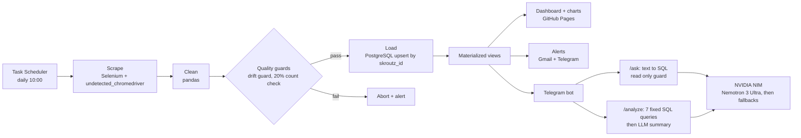

# Skroutz Price Intelligence

A daily data pipeline and AI assistant that tracks every phone, laptop, tablet and smartwatch price on [Skroutz.gr](https://www.skroutz.gr), with an evaluated text to SQL agent on top.

**Live dashboard:** [https://stavroskav.github.io/skroutz-data-pipeline/dashboard/dashboard_latest.html](https://stavroskav.github.io/skroutz-data-pipeline/dashboard/dashboard_latest.html)

[](https://github.com/StavrosKav/skroutz-data-pipeline/actions/workflows/ci.yml)
<!-- STATS:BADGES:START -->


<!-- STATS:BADGES:END -->


## What it does

1. Every day at 10:00, Windows Task Scheduler starts the pipeline.
2. Selenium with undetected_chromedriver scrapes the public listing pages of 4 categories: phones, laptops, tablets and smartwatches.
3. pandas cleans brands, models, specs and Greek price formats.
4. Data quality guards check the result. A markup drift guard stops the run if fields go missing, and a count check flags a run that is more than 20% off the 7 day average.
5. The loader upserts into PostgreSQL by `skroutz_id` (the Skroutz product number). This is the product key, so a product keeps its history even when Skroutz changes its URL.
6. Materialized views refresh, then charts and a self contained HTML dashboard are rebuilt and published to GitHub Pages.
7. A Telegram bot answers questions about the data with an LLM and sends the daily alerts.

Daily runs started on 25 May 2026, after a two week baseline in June 2025. About 6,600 products are listed on a normal day.

**Data story:** [what the snapshots reveal about Greek electronics pricing](docs/INSIGHTS.md)

## Architecture



More detail: [docs/PIPELINE.md](docs/PIPELINE.md) and [docs/ASK_AGENT.md](docs/ASK_AGENT.md).

## Data in the database

Products are counted once per `skroutz_id`, after merging duplicates created by URL changes. "Products" means every product ever seen, including products no longer listed.

<!-- STATS:TABLE:START -->
| Category | Products | Snapshots | Avg Price | Range | Brands (5+ products) |
|---|---|---|---|---|---|
| Laptop | 9,186 | 360,594 | €1,714 | €52–€12,266 | 25 |
| Phone | 4,859 | 193,077 | €338 | €9–€3,859 | 70 |
| Smartwatch | 6,728 | 402,516 | €92 | €4–€3,399 | 239 |
| Tablet | 1,862 | 70,813 | €569 | €31–€6,766 | 37 |
| **Total** | **22,635** | **1,027,000** | | | |

Updated daily via Task Scheduler · last pipeline run: 2026-10-30
<!-- STATS:TABLE:END -->

## The AI part

**`/ask <question>`** turns a Greek or English question into one SQL query, runs it on a read only connection and answers only from the returned rows. The bot shows the SQL it used, so every answer can be checked.

**`/analyze <category>`** does not let the model invent numbers. It first runs 7 fixed read only queries (price level, 30 day change, top brands, biggest drops and more), then asks the model to summarize only those facts. `/chat` is an alias of `/ask`.

**Model:** NVIDIA NIM `nvidia/nemotron-3-ultra-550b-a55b`. If it does not answer, the bot tries `nvidia/nemotron-3.5-bolt-e4b` and then `openai/gpt-oss-20b`.

**Current vs all time:** the database keeps products that are no longer listed. A question like "how many laptops do we have" counts products listed in the latest run. The bot counts all products ever seen only when the question says ever, all time or historically.

## AI evaluation

The eval set has 23 Greek and English questions over the real database. Each question has a reference SQL query. A question passes when the values the agent returns match the values of the reference query, so the check does not depend on wording.

Latest run with the production setup (Nemotron 3 Ultra, prompt v1): **23/23 on two runs, 30 Oct 2026** (`nvidia/nemotron-3-ultra-550b-a55b`, target 19/23). Earlier runs: 22/23 on 29 Oct; 20/23 on 30 Oct before three eval references were corrected.

Model and prompt comparison on the first 20 questions (28 Oct 2026, temperature 0, no fallback):

| Model | Prompt | Accuracy | Valid SQL | Median s | p90 s |
|---|---|---|---|---|---|
| `nvidia/nemotron-3.5-bolt-e4b` | v1 | 13/20 | 20/20 | 3.7 | 6.3 |
| `openai/gpt-oss-20b` | v1 | 18/20 | 20/20 | 18.7 | 130.2 |
| `nvidia/nemotron-3-ultra-550b-a55b` | v0 (no hints) | 16/20 | 20/20 | 23.5 | 45.1 |
| `nvidia/nemotron-3-ultra-550b-a55b` | v1 (production) | 18/20 | 20/20 | 29.5 | 41.4 |
| `nvidia/nemotron-3-ultra-550b-a55b` | v2 (few shot) | 17/20 | 19/20 | 18.7 | 45.3 |

What I took from it: Ultra with prompt v1 is the most accurate and has a usable tail latency. gpt-oss-20b is as accurate but its p90 is over 2 minutes. Bolt is 8 times faster but misses date and "still listed" filters. Few shot examples did not help. The set is small, so a 1 or 2 question gap is noise.

Fixed on 30 Oct: `atl_galaxy_s24` asked for the all time low of "the cheapest" Galaxy S24, which is ambiguous; it now asks for the lowest price any S24 variant ever had. Two other references (`apple_median_tablet`, `falling_trend_count`) included history or delisted products, against the bot's current-state rule, and were corrected. The prompt also gained general rules for status counts, current-price aggregates and variant answers.

Full results: [evals/RESULTS.md](evals/RESULTS.md). Conclusions: [evals/CONCLUSIONS.md](evals/CONCLUSIONS.md). Run it yourself: `python evals/run_ask_eval.py` or `python evals/compare.py`.

## Guardrails

Every SQL query the model writes goes through `agents/ask/guard.py` before it runs. The guard blocks:

* anything that is not a single `SELECT` (or `WITH ... SELECT`) statement
* more than one statement (`;` outside strings and comments)
* write and admin keywords: `INSERT`, `UPDATE`, `DELETE`, `DROP`, `CREATE`, `ALTER`, `TRUNCATE`, `GRANT`, `COPY`, `SET`, `SELECT INTO` and similar
* tables outside an allowlist of 9 analytics tables and views, so system catalogs (`pg_catalog`, `information_schema`, `pg_user`, `pg_stat_activity`) and internal tables are out of reach
* other schemas than `public`
* dangerous functions such as `pg_sleep`, `pg_read_file`, `dblink`, `set_config`, `current_setting`
* dollar quoted strings and unclosed comments or strings

It also adds `LIMIT 50` when there is no limit and caps any limit at 200 rows. The query then runs inside a `READ ONLY` transaction with a 5 second statement timeout, and the transaction is always rolled back. It connects as `skroutz_ask`, a separate database role that can only SELECT the allowed tables and views, is read only by default and has a 5 second timeout. If that role is not configured, `/ask` refuses to run instead of falling back to the pipeline user. Questions are cut to 500 characters. If the question is not about the data (for example the weather), the model returns a fixed "no data" query and the bot replies politely that it only answers questions about Skroutz prices. If the SQL fails, the model gets one chance to fix it with the error message.

## Engineering highlights

* **Stable product key:** `skroutz_id` with a unique constraint. A one off merge removed duplicates created by URL changes, with the snapshot count unchanged.
* **Observer stages:** charts, alerts, dashboard and README stats can fail without stopping the run.
* **Markup drift guard:** completeness thresholds per field before the CSV is written, plus a fixture test on real listing HTML.
* **Idempotent loads:** upserts, `UNIQUE(product_id, date)` on snapshots and a lock file, so a re run is safe.
* **Materialized analytics:** 16 views, 10 of them materialized and refreshed `CONCURRENTLY`.
* **CI on every push:** ruff, pytest, pip-audit and TruffleHog.

## Price trend charts

Average daily price for the 6 largest brands per category (7 day smoothed), rebuilt after every run.

**Laptops**


**Smartwatches**


**Tablets**


## Tech stack

| Layer | Tools |
|---|---|
| Scraping | Python 3.12, Selenium, undetected_chromedriver |
| Processing | pandas, numpy |
| Database | PostgreSQL 17, SQLAlchemy 2, materialized views, pg_trgm |
| AI | NVIDIA NIM (Nemotron 3 Ultra), text to SQL with a SQL guard, eval harness |
| Output | Self contained HTML dashboard (Chart.js), GitHub Pages |
| Alerts | Gmail SMTP, Telegram Bot API |
| Quality and ops | pytest, ruff, GitHub Actions (pip-audit, TruffleHog), Docker, Windows Task Scheduler |

## How to run

1. Install Python 3.12, create a venv, run `pip install -r requirements.txt`.
2. Copy `.env.example` to `.env` and fill in the DB settings. Gmail, Telegram and NIM keys are optional.
3. Create the schema once: `sql/create_new_schema.sql`, then `sql/analytics.sql`.
4. Run the pipeline: `python run_pipeline.py`.
5. Optional bot: `python -m alerts.telegram_bot`.
6. Tests and lint: `pytest` and `ruff check .`.
7. Eval: `python evals/run_ask_eval.py` (needs a NIM key and a loaded database).

The scrapers need a real Chrome window because headless mode is blocked. Docker covers only Clean and Load.

## Project structure

```
run_pipeline.py        orchestrator (scheduler entry: run_pipeline.bat, run_pipeline_wrapper.ps1)
core/                  paths and database connection
scrapers/              one scraper per category plus shared core
etl/                   cleaning and PostgreSQL loader
ops/                   data quality and scraper health checks
reporting/             dashboard and chart generation
alerts/                Gmail, Telegram bot, NIM client
agents/ask/            /ask text to SQL, SQL guard and /analyze grounded summary
evals/                 eval questions, checks, runner and model comparison
sql/                   schema, views, materialized views
tests/                 pytest, split by pipeline stage
dashboard/, charts/    published artifacts (GitHub Pages)
docs/                  pipeline, agent and insight write ups
```

## Scope and compliance

* Only four public category listing pages are scraped (`/c/40/`, `/c/25/`, `/c/1105/`, `/c/1705/`). They are not disallowed by [robots.txt](https://www.skroutz.gr/robots.txt).
* No login and no personal data. There are pauses of 1.2 to 3 seconds between page loads.
* No raw CSVs in git. The dashboard shows aggregated stats and a bounded sample of listings.

## Honest notes and limitations

* It runs on my own laptop, so a day is missed if the laptop is off.
* Smartwatch brand parsing is weak. Some rows have no brand or the brand "Smartwatch", so the table counts only brands with 5 or more products.
* Phone RAM is filled for about 68% of products.
* The eval set is small and written by me, so the score is a sanity check, not a benchmark.
* The free NIM catalog changes. Older models I used were retired, which is why there is a fallback chain.

## Roadmap

* Grow the eval set to about 50 questions and run it in CI.
* Fix smartwatch brands and phone spec fill rates.
* A lighter dashboard and a short demo video.
* Move scheduling off the laptop.

Personal portfolio project. MIT licensed.
