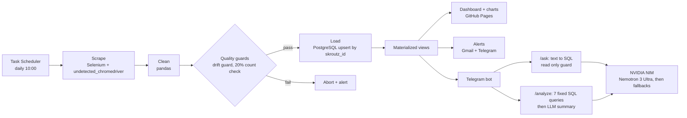

# Skroutz Price Intelligence

A daily data pipeline and an AI agent that tracks every phone, laptop, tablet and smartwatch price on [Skroutz.gr](https://www.skroutz.gr), with an evaluated text to SQL agent on top.

**Live dashboard:** [https://stavroskav.github.io/skroutz-data-pipeline/dashboard/dashboard_latest.html](https://stavroskav.github.io/skroutz-data-pipeline/dashboard/dashboard_latest.html)

[](https://github.com/StavrosKav/skroutz-data-pipeline/actions/workflows/ci.yml)
<!-- STATS:BADGES:START -->


<!-- STATS:BADGES:END -->
-blueviolet?style=flat-square)


## What it does

1. Every day at 10:00, Windows Task Scheduler starts the pipeline.
2. Selenium with undetected_chromedriver scrapes the public listing pages of 4 categories: phones, laptops, tablets and smartwatches.
3. pandas cleans brands, models, specs and Greek price formats.
4. Data quality guards check the result. A markup drift guard stops the run if fields go missing, and a count check flags a run that is more than 20% off the 7 day average.
5. The loader upserts into PostgreSQL by `skroutz_id` (the Skroutz product number). This is the product key, so a product keeps its history even when Skroutz changes its URL.
6. Materialized views refresh, then charts and a self contained HTML dashboard are rebuilt and published to GitHub Pages.
7. A Telegram bot answers questions about the data with an LLM and sends the daily alerts.

Daily runs started on 25 May 2026, after a two week baseline in June 2025. About 6,600 products are listed on a normal day.

**Data story:** [what the snapshots reveal about Greek electronics pricing](docs/INSIGHTS.md)

## Architecture



More detail: [docs/PIPELINE.md](docs/PIPELINE.md) and [docs/ASK_AGENT.md](docs/ASK_AGENT.md).

## Data in the database

Products are counted once per `skroutz_id`, after merging duplicates created by URL changes. "Products" means every product ever seen, including products no longer listed.

<!-- STATS:TABLE:START -->
| Category | Products | Snapshots | Avg Price | Range | Brands (5+ products) |
|---|---|---|---|---|---|
| Laptop | 9,196 | 365,102 | €1,717 | €52–€12,266 | 25 |
| Phone | 4,866 | 195,247 | €338 | €9–€3,859 | 70 |
| Smartwatch | 6,765 | 407,733 | €92 | €4–€3,399 | 241 |
| Tablet | 1,866 | 71,749 | €570 | €31–€6,766 | 37 |
| **Total** | **22,693** | **1,039,831** | | | |

Updated daily via Task Scheduler · last pipeline run: 2026-11-01
<!-- STATS:TABLE:END -->

## The AI part: an agent you can check

**`/ask <question>`** is a small text to SQL agent. You ask in Greek or English, for example "πόσα laptops έχουμε". The agent writes one SQL query, a guard checks it, it runs on a read only database role, and the bot answers only from the returned rows. The bot also shows the SQL it used, so every answer can be checked by a person. If the SQL fails, the agent gets one chance to fix it with the error message.

**`/analyze <category>`** does not let the model invent numbers. It first runs 7 fixed read only queries (price level, 30 day change, top brands, biggest drops and more), then asks the model to summarize only those facts. `/chat` is an alias of `/ask`.

**Model:** NVIDIA NIM `nvidia/nemotron-3-ultra-550b-a55b`. If it does not answer, the bot tries `nvidia/nemotron-3.5-bolt-e4b` and then `openai/gpt-oss-20b`.

**Current vs all time:** the database keeps products that are no longer listed. A question like "how many laptops do we have" counts products listed in the latest run. The bot counts all products ever seen only when the question says ever, all time or historically.

## How I evaluate the agent

I did not want to say "the bot works" without proof. So there is an eval with 23 Greek and English questions over the real database ([evals/ask_eval.yaml](evals/ask_eval.yaml)).

It works in 3 simple steps:

1. **Question.** The eval sends a real question to the agent, the same way a user would.
2. **Agent writes SQL.** The agent writes the SQL. It goes through the same read only guard and the same `skroutz_ask` role as in production.
3. **Checker compares values.** For every question I wrote a reference SQL query. It runs live on the same database in the same run, so the expected answer is always fresh. The checker ([evals/checks.py](evals/checks.py)) compares the values, not the text of the answer. Some price questions allow values up to 2% off.

The target is 80% (19/23).

**Current result: 23/23 on two runs, 30 Oct 2026** ([rerun3](evals/results/ask_eval_2026-10-30_rerun3.md), [rerun4](evals/results/ask_eval_2026-10-30_rerun4.md)). The score is not the same every time. On the same day, with the same setup, other runs gave 22/23 and 21/23 ([rerun1](evals/results/ask_eval_2026-10-30_rerun1.md), [rerun2](evals/results/ask_eval_2026-10-30_rerun2.md)). So I report a range, not one lucky number. On 31 Oct 2026, after the drop questions moved to the 7-day definition (`vw_drops_7d`), one run scored 22/23: all 3 drop questions passed, `new_products_week` failed ([report](evals/results/ask_eval_2026-10-31_drops7d.md)). After the Oct 31 changes (one "new this week" rule, PR #1), the latest single run with `nvidia/nemotron-3-ultra-550b-a55b` scored 23/23 ([report](evals/results/ask_eval_2026-10-31.md)). One run is not a range, so the 21–23 range above still stands.

### A passing example

Question: "how many laptops do we have" (`laptops_count_current`). The agent counted only laptops listed in the latest run and returned 2,170. The reference SQL returned the same value, so it passed. The all time version of the question (`laptops_count_all_time`) expects 9,186, and the agent also got that right. This shows the agent understands the difference between "now" and "ever".

### A failing example and what I learned

The first run on 30 Oct scored 20/23 ([report](evals/results/ask_eval_2026-10-30.md)). When I looked at the 3 failures, the eval itself had problems:

* `falling_trend_count`: the reference expected 640 products with a falling price, the agent said 552. The reference also counted products that are no longer listed. That breaks the bot's own rule (count only current products). The agent was right, so I fixed the reference.
* `apple_median_tablet`: the same problem. The reference expected 929.00, the agent gave 872.75 using only current tablets. I fixed the reference.
* `atl_galaxy_s24`: the question asked for the all time low of "the cheapest" Galaxy S24, which is not clear. Now it asks for the lowest price any S24 variant ever had (436.48).

After the fix, the same two questions still sometimes fail: in rerun1 and rerun2 the agent sometimes answered 640 or 929.00 again. **Lesson:** a wrong eval can hide a correct model, so a failure must be read before it is trusted. And one run is not enough, because the model does not answer the same way every time.

### What the eval does not check

* The wording of the answer. Only the values are compared.
* Speed. Latency is written in the report but it does not affect pass or fail.
* The SQL itself. A different query that gives the right values still passes.
* It is not in CI. It needs the real database and a NIM key, so I run it by hand (`python evals/run_ask_eval.py`).
* 23 questions written by me is a small set. It is a sanity check, not a benchmark.

## Model comparison

On 30 Oct 2026 I ran the same 23 questions with one NVIDIA NIM model at a time, fallback off, so each score belongs to that model only ([full report](evals/results/model_comparison_2026-10-30.md)).

| Model | Complete runs | Score per run | Median latency / question | p90 latency / question |
|---|---|---|---|---|
| `nvidia/nemotron-3-ultra-550b-a55b` | 1 | 22/23 | 25.5 s | 58.0 s |
| `openai/gpt-oss-20b` | 2 | 21/23, 17/23 | 26.2 s | 134.5 s |
| `nvidia/nemotron-3.5-bolt-e4b` | 1 | 13/23 | 3.6 s | 5.0 s |

To be honest about the limits:

* The NIM free tier stopped some runs. Two more Ultra runs ended with `429 Too Many Requests`, and a second Bolt run got `404 Not Found`. Those runs are not counted, so Ultra and Bolt have only one run each.
* Ultra's one miss (`new_products_week`) was a timeout, not a wrong answer.
* In gpt-oss-20b run 2, 5 questions hit a read timeout and 4 of them count as fails. So most of the 21 vs 17 gap is the service, not the model's SQL.
* Bolt is very fast but wrong on 10 of 23. Its misses are logic errors, not timeouts, so it does not reach the 80% target.

What I take from it: Ultra gives the most correct answers and stays the main model. gpt-oss-20b is close when NIM is healthy but slower in the tail. Bolt stays a fallback only. I need more runs per model to measure the real spread.

An older test on 28 Oct with only 20 questions is kept as history in [evals/RESULTS.md](evals/RESULTS.md).

## Safety: the agent can only read

Every SQL query the model writes goes through `agents/ask/guard.py` before it runs. The guard blocks:

* anything that is not a single `SELECT` (or `WITH ... SELECT`) statement
* more than one statement (`;` outside strings and comments)
* write and admin keywords: `INSERT`, `UPDATE`, `DELETE`, `DROP`, `CREATE`, `ALTER`, `TRUNCATE`, `GRANT`, `COPY`, `SET`, `SELECT INTO` and similar
* tables outside an allowlist of 9 analytics tables and views, so system catalogs and internal tables are out of reach
* other schemas than `public`
* dangerous functions such as `pg_sleep`, `pg_read_file`, `dblink`, `set_config`, `current_setting`
* dollar quoted strings and unclosed comments or strings

It also adds `LIMIT 50` when there is no limit and caps any limit at 200 rows. The query runs inside a `READ ONLY` transaction with a 5 second timeout, and the transaction is always rolled back.

All bot commands connect as `skroutz_ask`, a separate database role that can only SELECT the allowed tables and views. If that role is not configured, the bot refuses to run instead of falling back to the pipeline user ([tests/test_ask_db_role.py](tests/test_ask_db_role.py)).

I also tried to break the guard myself: [tests/test_guard_bypass.py](tests/test_guard_bypass.py) has 35 attack queries (hidden statements, comments, system tables, dangerous functions and more). All of them must be blocked, and they run in CI on every push.

Questions are cut to 500 characters. If the question is not about the data (for example the weather), the bot replies politely that it only answers questions about Skroutz prices.

## Engineering highlights

* **Stable product key:** `skroutz_id` with a unique constraint. A one off merge removed duplicates created by URL changes, with the snapshot count unchanged.
* **Observer stages:** charts, alerts, dashboard and README stats can fail without stopping the run.
* **Markup drift guard:** completeness thresholds per field before the CSV is written, plus a fixture test on real listing HTML.
* **Idempotent loads:** upserts, `UNIQUE(product_id, date)` on snapshots and a lock file, so a re run is safe.
* **Materialized analytics:** 26 views, 10 of them materialized and refreshed `CONCURRENTLY`.
* **Latest scrape date, not today's date:** the bot commands, the dashboard queries and all date based views count from the last scrape day (`MAX(date)` in `price_snapshots`). So if the laptop misses a day, "today" still means the last real data.
* **Stuck runs close by themselves:** a run still marked `running` after 6 hours is closed as `aborted_stale` at the next start.
* **Daily database backup:** a dump is checked with `pg_restore --list`, and dumps older than 7 days are deleted.
* **383 tests** in pytest.
* **CI on every push:** ruff, pytest, pip-audit and TruffleHog.

## Dashboard notes

* Prices are the cheapest shop's "from" price on Skroutz, not one fixed shop.
* Cards and trend charts use medians. The Category Price Index follows the same products from the first day (= 100, geometric mean of price ratios).
* "Buy or wait" compares each product's price today with its own 90-day low, median and high.
* "New this week" means first seen in the 7 most recent days and still listed on the latest day. The dashboard, Telegram and the `/ask` bot use this one rule.
* The daily run warns (it does not fail) when a category lists under 85% of its 7-day average.

## Price trend charts

Average daily price for the 6 largest brands per category (7 day smoothed), rebuilt after every run.

**Laptops**


**Smartwatches**


**Tablets**


## Tech stack

| Layer | Tools |
|---|---|
| Scraping | Python 3.12, Selenium, undetected_chromedriver |
| Processing | pandas, numpy |
| Database | PostgreSQL 17, SQLAlchemy 2, materialized views, pg_trgm |
| AI | NVIDIA NIM (Nemotron 3 Ultra), text to SQL with a SQL guard, eval harness |
| Output | Self contained HTML dashboard (Chart.js), GitHub Pages |
| Alerts | Gmail SMTP, Telegram Bot API |
| Quality and ops | pytest, ruff, GitHub Actions (pip-audit, TruffleHog), Docker, Windows Task Scheduler |

## How to run

1. Install Python 3.12, create a venv, run `pip install -r requirements.txt`.
2. Copy `.env.example` to `.env` and fill in the DB settings. Gmail, Telegram and NIM keys are optional.
3. Create the schema once: `sql/create_new_schema.sql`, then `sql/analytics.sql`.
4. Run the pipeline: `python run_pipeline.py`.
5. Optional bot: `python -m alerts.telegram_bot`.
6. Tests and lint: `pytest` and `ruff check .`.
7. Eval: `python evals/run_ask_eval.py` (needs a NIM key and a loaded database).

The scrapers need a real Chrome window because headless mode is blocked. Docker covers only Clean and Load.

## Project structure

```
run_pipeline.py        orchestrator (scheduler entry: run_pipeline.bat, run_pipeline_wrapper.ps1)
core/                  paths and database connection
scrapers/              one scraper per category plus shared core
etl/                   cleaning and PostgreSQL loader
ops/                   data quality and scraper health checks
reporting/             dashboard and chart generation
alerts/                Gmail, Telegram bot, NIM client
agents/ask/            /ask text to SQL, SQL guard and /analyze grounded summary
evals/                 eval questions, checks, runner and model comparison
sql/                   schema, views, materialized views
tests/                 pytest, split by pipeline stage
dashboard/, charts/    published artifacts (GitHub Pages)
docs/                  pipeline, agent and insight write ups
```

## Scope and compliance

* Only four public category listing pages are scraped (`/c/40/`, `/c/25/`, `/c/1105/`, `/c/1705/`). They are not disallowed by [robots.txt](https://www.skroutz.gr/robots.txt).
* No login and no personal data. There are pauses of 1.2 to 3 seconds between page loads.
* No raw CSVs in git. The dashboard shows aggregated stats and a bounded sample of listings.

## Honest notes and limitations

* It runs on my own laptop, so a day is missed if the laptop is off.
* The price history has gaps: the database has prices on 150 of the 509 calendar days from 10 June 2025 to 31 October 2026. Charts and the 90-day "Buy or wait" use only days that were actually scraped.
* Every price is the cheapest shop's "from" price on the listing card, so a "drop" can be a cheaper shop appearing, not a shop cutting its price.
* Smartwatch brand parsing is weak. Some rows have no brand or a fake brand ("Smartwatch", "Έξυπνο"). The dashboard hides these two in brand tables and charts (the data is unchanged), and counts only brands with 5 or more products.
* Phone RAM is filled for about 68% of products.
* The eval set is small and written by me, so the score is a sanity check, not a benchmark. The score also changes from run to run.
* The free NIM catalog changes. Older models I used were retired, which is why there is a fallback chain.

## Roadmap

* Grow the eval set to about 50 questions and run it in CI.
* Fix smartwatch brands and phone spec fill rates.
* A lighter dashboard and a short demo video.
* Move scheduling off the laptop.

Personal portfolio project. MIT licensed.
