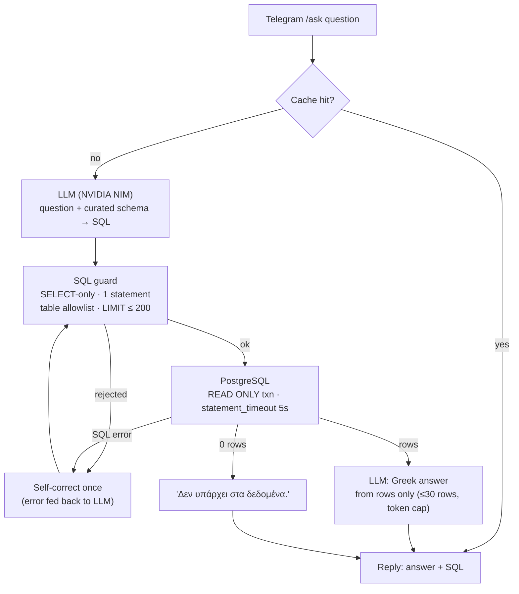

# `/ask` — grounded text-to-SQL agent

Ask the price database a question in Greek (or English) from Telegram and get
an answer built **only** from rows returned by a read-only SQL query, with the
SQL shown underneath.

```
/ask ποιο είναι το φθηνότερο iPhone 15 σήμερα;
```

## Architecture



| Piece | File | Notes |
|---|---|---|
| Orchestration | `agents/ask/agent.py` | Pure: LLM and executor are injected callables. Cache (LRU-ish, 1 h TTL), token caps, one self-correction round. |
| SQL guard | `agents/ask/guard.py` | Strips strings/comments, then: first word SELECT/WITH, no `;`, no DDL/DML/`SET`/`COPY`/`INTO`, no dangerous functions (`pg_sleep`, `dblink`, …), only allowlisted relations or CTEs, LIMIT enforced. |
| Schema context | `agents/ask/schema.py` | ~15 lines describing the 9 allowlisted relations. Same list is the allowlist. |
| Retries | `agents/ask/retry.py`, `alerts/nim_client.py` | Retry only timeouts, network errors, 429, 5xx. Other 4xx fail fast. |
| Runtime adapters | `agents/ask/runtime.py` | NIM LLM + read-only Postgres executor. The only file that touches network/DB. |
| Telegram | `alerts/telegram_nim.py` (`cmd_ask`) | `/ask`; `/chat` is an alias of `/ask`. |
| Category brief | `agents/ask/analyze.py` | `/analyze <category>`: 7 fixed, category-scoped SELECTs (each passed through the same guard) → fact lines → LLM summarizes **only** those facts; the facts are shown under the summary. If NIM fails, the facts are returned alone. |

Defence in depth: even if the guard missed something, the query runs inside
`SET TRANSACTION READ ONLY` with `SET LOCAL statement_timeout`, and the
transaction is always rolled back. For production, also use a dedicated DB
role with `SELECT` on the allowlisted relations only.

## Evaluation

`evals/ask_eval.yaml` holds 23 Greek and English questions (cheapest product, biggest drop
this week, counts per category, price history, ATL, ratings, one out-of-scope
question). Each has a **reference SQL** run live on the DB; the check compares
result *values* (top-1, scalar with tolerance, or set overlap), never answer text.

```
python evals/run_ask_eval.py          # prints PASS/FAIL per item + accuracy
```

Target: **≥ 19/23** (80% of the items). Latest runs (30 Oct 2026,
`nvidia/nemotron-3-ultra-550b-a55b`, prompt v1): the score changes from run to run. The five runs on that day gave 20, 22, 21, 23 and 23 out of 23 (reports in `evals/results/`). The first run was 20/23 because 3 reference answers were wrong; they were fixed before the reruns. One model at a time is compared in `evals/results/model_comparison_2026-10-30.md`. On 31 Oct 2026, after the drop questions moved to the 7-day definition (`vw_drops_7d`), one run scored 22/23: all 3 drop questions passed, `new_products_week` failed ([report](../evals/results/ask_eval_2026-10-31_drops7d.md)). After the Oct 31 changes (one "new this week" rule, PR #1), the latest single run with `nvidia/nemotron-3-ultra-550b-a55b` scored 23/23 ([report](../evals/results/ask_eval_2026-10-31.md)). One run is not a range, so the 21–23 range above still stands. If NIM returns 429, 404, 5xx or a timeout, the eval retries the question up to 3 times and then counts it as FAIL, so the run always finishes. Per-item SQL, answer, attempts and latency are written to
`evals/last_run.json` (git-ignored).

No AI command answers from model knowledge: the old ungrounded `/chat`
(free LLM chat) and `/summarize` were removed; `/chat` now routes to `/ask`.

Unit tests (`tests/test_ask_agent.py`, `tests/test_analyze_grounded.py`) use a fake LLM and fake executor: guard
rejections, LIMIT capping, empty-result path, self-correction, cache, retry policy.
